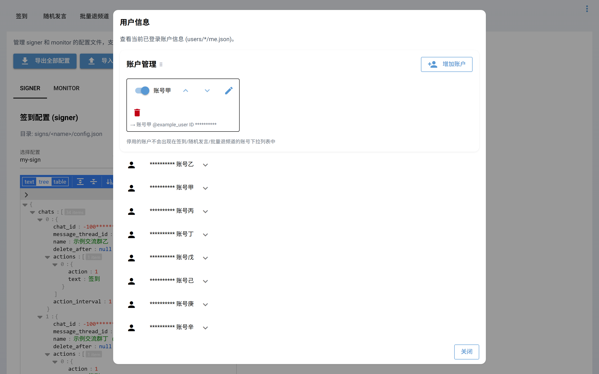
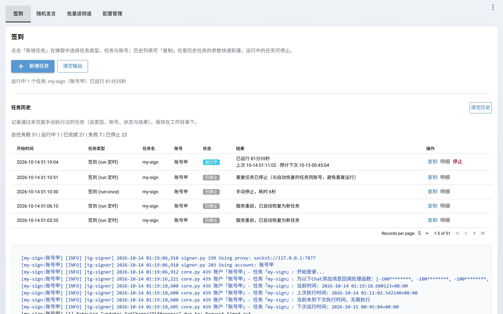
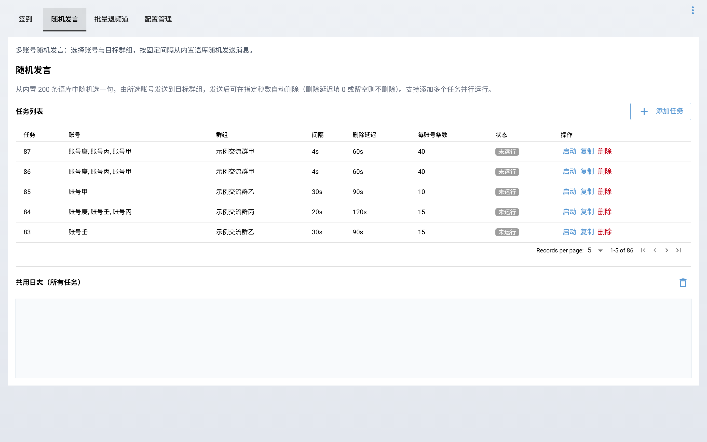
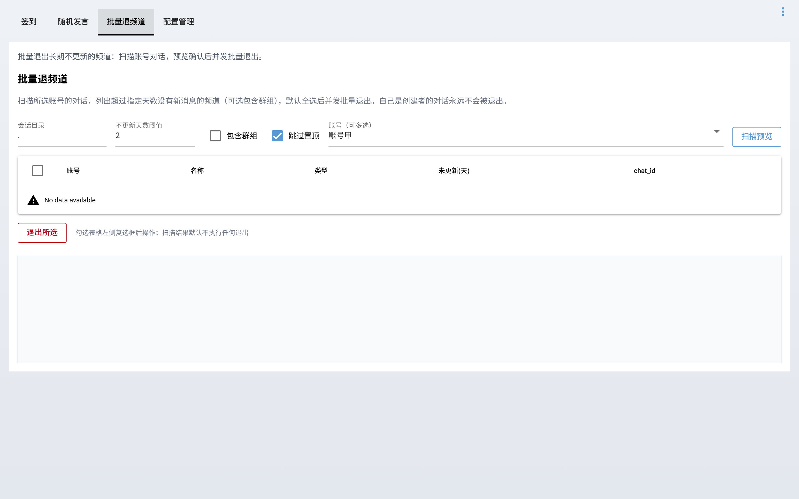
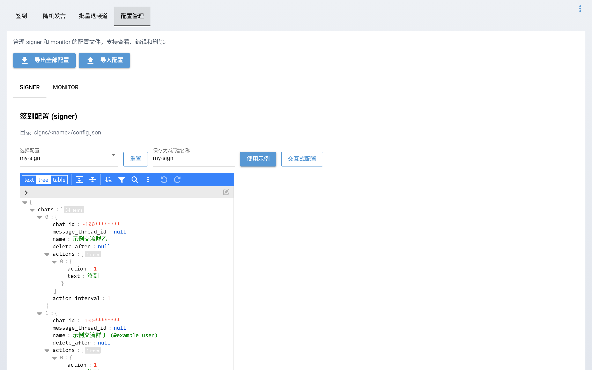

# Telegram 自动签到 Web 控制台

基于 [amchii/tg-signer](https://github.com/amchii/tg-signer) 的 fork，PyPI 包名 `tg-signer-plus`，提供图形化 WebUI：多账号定时签到、随机发言、批量退频道与配置管理，手机浏览器可直接使用。

## 启动

```sh
pip install "tg-signer-plus[gui]"
tg-signer-plus                 # 启动后浏览器访问 http://127.0.0.1:8080（等价于 tg-signer-plus webgui）
# 可选访问密码：tg-signer-plus --auth-code <你的密码>
```

程序不读取系统代理，需要代理时先设置环境变量：

```sh
# bash
export TG_PROXY=socks5://127.0.0.1:7877
# PowerShell
$env:TG_PROXY="socks5://127.0.0.1:7877"
```

页面包含「签到 / 随机发言 / 批量退频道 / 配置管理」四个标签页（刷新后自动回到上次选中的标签），右上角「⋮ 菜单」内有：工作目录 / 用户信息（账户管理）/ 签到记录 / 日志。

## 手机上运行（Termux）

无需电脑，安卓手机安装 [Termux](https://f-droid.org/packages/com.termux/)（请用 F-Droid 版，Google Play 版已停止更新）后即可直接运行：

```sh
pkg update && pkg install python -y
pip install "tg-signer-plus[gui]"
# 如个别依赖编译报错，补装编译工具链后重试：
# pkg install clang rust binutils -y
```

启动并保持后台运行：

```sh
termux-wake-lock                              # 防止系统休眠杀进程（很重要）
export TG_PROXY=socks5://127.0.0.1:7877       # 手机上挂了代理才需要，端口按实际改
tg-signer-plus
```

然后用手机浏览器访问 **http://127.0.0.1:8080** 即可，页面已做移动端适配；账号登录、配置、签到等全部操作与电脑端一致。

实用提示：

- **长时间后台运行**：保持 Termux 在前台或最近任务列表中，配合 `termux-wake-lock`；也可装 tmux（`pkg install tmux`）在会话内运行，断 SSH/切应用后任务不中断
- **开机/后台自启**：可用 Termux:Boot 插件，在 `~/.termux/boot/` 下放启动脚本
- **电脑访问手机上的界面**：启动时加监听参数并务必设置访问密码——`tg-signer-plus --host 0.0.0.0 --auth-code <你的密码>`，电脑浏览器访问 `http://<手机局域网IP>:8080`
- **省电策略**：在系统设置中关闭 Termux 的电池优化，否则息屏后定时签到可能被系统暂停
- 手机与电脑**不要同时运行同一账号的 session**，否则会触发 `AUTH_KEY_DUPLICATED` 吊销会话；换机运行时请先停掉旧设备上的任务

## 账户管理（右上角 ⋮ 菜单 → 用户信息）



点击页面右上角「⋮」菜单，选择「用户信息」打开账户管理弹窗，顶部「账户管理」卡片内可对账号进行全部操作，下方列表展示各账号的 Telegram 资料（ID、用户名、手机号等，点箭头展开）。

- **增加账户**：点右上角「增加账户」，网页内输入账号名、手机号与验证码（必要时两步验证密码）即可登录，自动落盘 `<账号名>.session`，无需命令行
- **停用 / 启用**：点账户卡片上的开关；停用的账号不会出现在签到、随机发言、批量退频道的账号下拉列表中，但登录凭据保留
- **调整顺序**：拖动账户卡片，或点「↑ / ↓」上下移动；顺序在签到、随机发言、批量退频道的账号下拉中全局生效并持久化
- **重命名**：点铅笔图标修改账号显示名
- **删除账户**（垃圾桶图标）：二次确认后删除该账户的 `.session` / `.session_string` 文件，不可恢复；删除前请先停止使用该账户的任务，否则文件被占用会导致删除失败

同一菜单内还有：**工作目录**（切换/查看 `.signer` 数据目录）、**签到记录**（查看各账号每日签到情况）、**日志**（查看服务运行日志）。

> **当前限制**
> - 暂无「重新登录」入口：会话失效（如密钥被吊销）后，需先删除该账户再重新「增加账户」登录
> - 删除账户不会自动断开运行中的连接：请先停止使用该账户的所有任务，否则 Windows 下可能因 session 文件被占用而删除失败
> - 同一 `.session` 文件不可在多个设备/实例同时运行，否则会触发 Telegram `AUTH_KEY_DUPLICATED` 导致会话被吊销

## 签到



- 「新增任务」选择任务类型与账号（可多选）；多账号的启动顺序、每个账号的频道执行顺序都会随机打乱：
  - **签到 (run-once)**：立即执行一次，即使今天已经签过
  - **签到 (run 定时)**：常驻进程，每天按配置的签到时间（`HH:MM:SS` 或 crontab 表达式）自动签到，并叠加配置的随机误差秒数
  - **自动化 / 监控**：运行 automation / monitor 配置
- 输出区实时滚动各账号日志；任务历史支持「停止 / 复制参数 / 明细」，明细按账号 × 频道展示成功失败，可点分账号统计筛选
- 运行中的定时任务实时显示：已运行时长、上次执行时间、预计下次执行时间
- 定时语义：启动时若当天签到时刻**尚未到**，会等待到点再执行；时刻已过且当天未签才立即补签；当天已签不会重复执行
- **服务重启后自动恢复**：上次处于运行中的「签到 (run 定时)」任务会在打开页面时自动拉起（run-once 一次性任务不恢复）；Windows 下任务子进程随服务退出自动结束，不会残留无法停止的孤儿进程

## 随机发言



- 「新增任务」表单：选择账号（可多选）、目标群组（手动输入 chat_id / @username，或从最近聊天下拉选择，仅显示群组）、发送间隔、删除延迟、每账号发送条数
- 点击「添加任务」创建并自动启动，支持多个任务并行运行
- 每个账号独立计时：实际间隔 = 设定秒数 + 随机 0~3 秒，从内置 200 条语料库随机选句发送到目标群组
- 删除延迟填 0 或留空则消息不删除；否则发送 N 秒后自动撤回，停止任务后剩余消息仍按延迟依次撤回
- 每个任务支持「启动 / 停止 / 复制 / 删除」；任务配置持久化，刷新页面或重启服务后自动恢复
- 底部共用日志区展示所有任务日志，每行带 `[#任务编号]` 前缀，发送与撤回记录显示群聊名称

## 批量退频道



- 设置「不更新天数阈值」、选择账号（可多选）后「扫描预览」，列出长期不更新的频道/群组及最后消息时间；阈值填 0 表示扫描全部频道/群组（此时不允许自动退出）
- 扫描结果**仅预览不执行**：勾选对话并二次确认后才会批量退出
- 默认不勾选名称包含「抽奖」「嫩妹社」「野寻」「榜」等关键词的对话，防止误退

## 配置管理



- 在线查看 / 编辑 / 删除 signer 与 monitor 配置（JSON 编辑），打开页面默认加载第一个配置
- 「导出全部配置」下载 ZIP 备份：含签到/监控配置、账户状态与排序、最近聊天/用户信息缓存、批量退频道配置；**不含** session 登录凭据、随机发言任务与任务历史
- 「导入配置」支持 ZIP 备份与 JSON 配置两种格式，同名配置覆盖；迁移到新设备时 session 文件需另行复制
